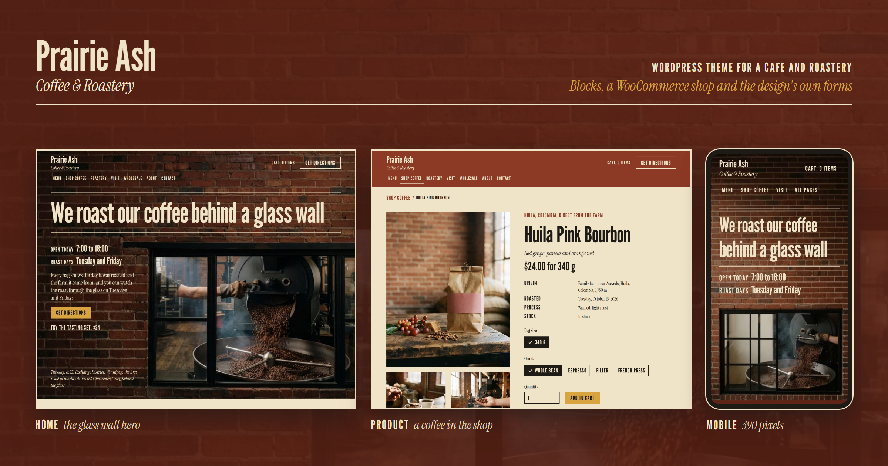

# Prairie Ash

A WordPress theme for a cafe and coffee roastery: Prairie Ash Coffee & Roastery, a fictional business in the
Exchange District of Winnipeg. Every content section of every page is a block with named fields and the block
editor's own styling controls, the shop runs on WooCommerce with the design's own templates for the shop,
product, cart, checkout and order confirmation, the forms run on Formidable Forms with the design's own markup,
and the motion layer honours the visitor's reduced motion setting.

The theme ships with its demo content: the pages, the coffees, the menus, the forms, shipping, the demo
payment method, the theme settings and the photographs, imported with one button.

## Requirements

| Software | Version the theme is tested with | Needed |
|---|---|---|
| WordPress | 7.1.4 (the theme requires 7.0 or later) | yes |
| PHP | 8.1 or later (tested on 8.3) | yes |
| Secure Custom Fields | 6.9.8 | yes, the block fields and the theme settings |
| WooCommerce | 11.2.1 | yes, the shop |
| Formidable Forms | 7.0 | yes, the signup, contact and wholesale forms |
| FluentSMTP | 2.4.1 | recommended, to send the forms' and the shop's mail through a real mail service |

ACF PRO can stand in for Secure Custom Fields: the theme uses the functions the two share.

While a required plugin is missing, every admin screen shows a notice that names it, with its tested version and
a link to install or activate it. The plugins are not bundled with the theme.

The PHP image library has to write WebP and AVIF for the theme's image formats. Where it cannot write AVIF, the
theme serves WebP and the original JPEG, and where it can write neither, the original JPEG alone.

## Install

1. Install WordPress.
2. Install and activate Secure Custom Fields, WooCommerce and Formidable Forms from Plugins, Add New.
3. Copy the theme folder to `wp-content/themes/prairie-ash`, or upload it as a zip under Appearance, Themes,
   Add New, and activate it.

## Import the demo content

From the admin: Appearance, Demo content, then Import demo content. The screen shows each step as it runs and
says when the demo is in place. On a host with a short time limit the import runs in several requests by
itself, and an import that was broken off carries on where it stopped when the button is pressed again.

From the command line, the same import:

    wp prairie-ash-demo import

The import:

- creates the 16 pages with their sections and field values, and sets the front page, the privacy page and
  the shop, cart and checkout pages;
- creates the seven products, six coffees with their bag sizes and grinds as variations and the tasting set,
  with prices, stock and photographs;
- creates the main navigation and the footer links and puts them in their places;
- imports the three forms through Formidable's own import, with the design's markup and their confirmation
  pages;
- creates the shipping zone for Manitoba, Saskatchewan, Alberta and Ontario with shipping and pickup, pickup
  everywhere else, and the demo payment method, which takes orders without a charge;
- writes the site title and tagline, the time zone, the permalinks (`/%postname%/`), the store settings, and the
  theme's Site settings and Shop wording;
- uploads the 51 photographs, so WordPress writes every size the theme uses, then writes an AVIF and a WebP copy
  of each, one copy at a time, so a host with a 30 second time limit and a 128 MB memory limit finishes it.

It is meant for a new site: it sets the site title, the front page, the permalinks and the store settings, and
moves the sample post and pages a new WordPress and WooCommerce start with to the trash, and removes the
sample contact form Formidable adds while it has no entries. WooCommerce's My account page stays in place.
Running it again updates the same records and creates nothing twice. No user, order, form entry or mail setting
is imported.

On a site that already has orders, products, pages or posts of its own, the screen lists them, names any page
of its own that sits under a demo address and would be overwritten, and imports only after the box below the
list is ticked. The command asks before it starts, or takes `--yes`. The command runs as a user allowed to post
unfiltered HTML, because the forms carry the design's own markup: `--user=<administrator>`, or a super admin
on multisite. One import or repair runs at a time.

On Apache the permalinks need a writable `.htaccess`, or the rules shown under Settings, Permalinks.

## Repair the image copies

A copy that the server cannot write, for lack of memory or time, is never offered to a browser: the page offers
the next format in its place, WebP and then the original JPEG or PNG. The Demo content screen counts the copies
that are missing or empty and lists each copy that could not be written, with the reason.

Image copies, Repair image copies writes every missing, empty or unreadable copy of every JPEG and PNG in the
media library, a few at a time, and lists what still cannot be written. Running the import again does the same
for the demo images. The screen shows the last count: on the first visit for a library of up to 300 images,
after Count the copies again, or after a finished repair. Copies that could not be written are listed apart
from copies that are only missing. One import or repair runs at a time. From the command line:

    wp prairie-ash-demo repair-images

The demo data lives in `demo/`: `content.json`, `forms.xml` and the photographs under `demo/media/`. The
command `wp prairie-ash-demo export` writes that folder again from a site built with the theme, with only the
attachments the records use.

## Mail

The theme sends nothing by itself. Form notifications, if a form is given one in Formidable, and WooCommerce's
order mail go through WordPress mail, which FluentSMTP can hand to a real mail service. The demo sets no
sender, no recipient and no mail credentials: those belong to the business running the site.

## Development

The design's styles and scripts are compiled from `src/` into `assets/`:

    npm install
    npm run build

The PHP follows the WordPress Coding Standards:

    composer install
    composer run lint

## Credits and licences

- The theme: GPL-2.0-or-later, see `LICENSE`.
- GSAP 3.15.0 and its plugins, bundled in `assets/js/`: the GSAP Standard License,
  https://gsap.com/standard-license. It is free of charge and it is not the GPL. Its licence notices are kept
  in `assets/js/main.js.LICENSE.txt`.
- League Gothic and Instrument Serif, self-hosted in `assets/fonts/`: SIL Open Font License 1.1, with the licence
  texts beside the font files (`OFL-LeagueGothic.txt`, `OFL-InstrumentSerif.txt`).
- The business, its people, its address and its contact details are fictional, and the phone number uses the
  555 range reserved for fiction.
